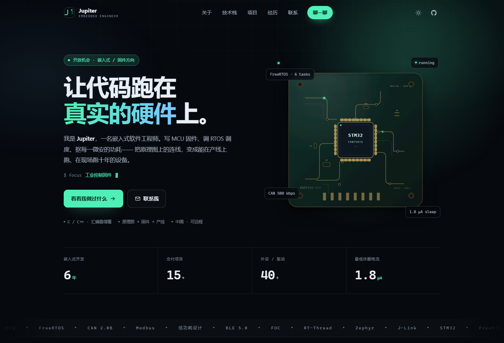

# jupiter.github.io

Jupiter 的个人主页 —— 嵌入式软件工程师。

纯静态站点：手写 HTML / CSS / JavaScript，**没有构建步骤、没有 npm 依赖、没有外部字体请求**。
克隆下来双击 `index.html` 就能看，推到 GitHub 就能上线。

线上地址：<https://jupiter1028.github.io/jupiter.github.io/>

> 注意：GitHub 用户名是 `Jupiter1028`，而这个仓库叫 `jupiter.github.io`，两者不一致，
> 所以它现在是**项目页**（地址带 `/jupiter.github.io/` 前缀），不是 `https://jupiter1028.github.io/` 根域名。
> 想要根域名的话见下方「换成根域名」。

## 预览



移动端预览见 [`docs/preview-mobile.png`](docs/preview-mobile.png)。

---

## 本地预览

```bash
# 方式一：直接打开
start index.html

# 方式二：起一个本地服务器（推荐，避免 file:// 的剪贴板限制）
python -m http.server 8000
# 然后访问 http://localhost:8000
```

## 目录结构

```
.
├── index.html              # 单页主体：导航 / Hero / 关于 / 技术栈 / 项目 / 经历 / 联系
├── 404.html                # GitHub Pages 自定义 404
├── assets/
│   ├── css/style.css       # 设计令牌 + 全部样式（暗/亮双主题、响应式、动效）
│   ├── js/main.js          # 主题记忆、滚动显现、数字滚动、打字机、复制邮箱
│   └── img/
│       ├── favicon.svg     # 站点图标
│       ├── wechat-qr.png   # 微信二维码（当前是占位图，替换成你的）
│       └── og-cover.png    # 社交分享封面（1200×630）
├── robots.txt
├── sitemap.xml
├── .nojekyll               # 让 GitHub Pages 跳过 Jekyll 处理
└── .github/workflows/
    └── deploy.yml          # push 到 main 自动部署到 Pages
```

## 改成你自己的内容

站内文案都是直接写在 `index.html` 里的，按区块搜关键字即可定位。
**下面这些是示例内容，请务必替换成你的真实信息**（尤其是经历和项目，别直接上线）。

| 位置 | 需要改什么 |
| --- | --- |
| `index.html` `<head>` | `<title>`、`description`、`og:*`、`canonical`、JSON-LD 里的姓名与链接 |
| 顶部导航 `.brand` | 名字 `Jupiter`、副标题 `EMBEDDED ENGINEER` |
| Hero `.hero` | 状态胶囊（在职 / 求职）、大标题、自我介绍、`$ focus` 轮播词 |
| `.stats` | 4 个数字：年限、项目数、驱动数、休眠电流 |
| `#about` | 自我介绍三段、3 条工作原则、`最近在折腾` |
| `#skills` | 6 个技能卡片里的标签（绿色 `.chip--core` 表示最熟的） |
| `#work` | 4 个项目：标题、描述、3 个指标、标签、仓库链接 |
| `#experience` | 3 段经历：时间、职位、公司、成果条目、右侧技术标签 |
| `#contact` | 邮箱、GitHub、坐标、状态；`.contact__facts` 里的资料；微信卡片里的文案 |
| 页脚 | 版权年份（JS 会自动更新） |

联系方式在文件里出现多次（导航按钮、联系区按钮、`data-mail`、`mailto:` 链接），
全局搜索 `543258223@qq.com` 一次替换最省事，记得同步 `data-mail` 属性。

### 换配色

所有颜色都在 `assets/css/style.css` 顶部的 `:root` 和 `[data-theme="light"]` 里：

```css
--accent: #4ff0b7;   /* 主色（薄荷绿） */
--accent-2: #78c9ff; /* 渐变副色（青蓝） */
--bg: #06090e;       /* 背景 */
```

### 换字体

默认使用系统字体（Inter / PingFang SC / Microsoft YaHei），不请求外链。
想用自定义字体，把字体文件放进 `assets/fonts/`，在 `style.css` 里加 `@font-face` 并改 `--font-sans` 即可。

### 换微信二维码

「聊一聊」点开的是三选一面板：**扫码加微信 / 唤起微信 / 发邮件**。

二维码目前是一张占位图，换成你自己的：

1. 手机微信 →「我」→ 点自己的头像 →「二维码名片」，截图或保存
2. 存成 `assets/img/wechat-qr.png`，**同名覆盖**（建议正方形，400×400 以上）
3. 提交推送即可，代码不用改

说明：个人微信没有开放「网页直接跳到某个人的聊天窗口」的接口，
所以「微信直接联系」用的是 `weixin://`，只能在手机上唤起微信 App，无法定位到具体会话；
桌面端请以二维码为主。如果以后你有企业微信客服链接，可以直接替换那个按钮的 `href`，那个能直达对话。

## 部署

仓库自带 `.github/workflows/deploy.yml`，推送到 `main` 后会自动发布：

1. 打开仓库 **Actions** 标签，等 `Deploy to GitHub Pages` 跑完（约 1 分钟）
2. 访问 <https://jupiter1028.github.io/jupiter.github.io/>

首次运行时 workflow 会尝试自动开启仓库的 Pages。如果这一步因为权限被跳过，
手动开一次即可（只需一次）：

1. **Settings → Pages**
2. **Source** 选 `GitHub Actions`（若想改用分支部署，选 `Deploy from a branch` → `main` / `/ (root)`）
3. 回到 **Actions**，点一次 `Re-run all jobs`

推送更新：

```bash
git add -A
git commit -m "update: 更新项目经历"
git push
```

### 换成根域名

想让地址变成 `https://jupiter1028.github.io/`：

1. 仓库 **Settings → General → Rename**，把仓库名改成 `Jupiter1028.github.io`（和用户名一致）
2. Pages 配置会跟着迁移，之后地址就是根域名
3. 把 `index.html` 里的 `canonical`、`og:url`、`og:image`、`twitter:image`、JSON-LD 的 `url`，
   以及 `sitemap.xml`、`robots.txt` 里的绝对地址，从 `/jupiter.github.io/...` 改成根地址
4. 提交推送即可

> 项目页位于子路径时，`robots.txt` 不会被搜索引擎读取（它只读根域名的 `/robots.txt`），
> 换成根域名后这份文件就会生效。

### 绑定自定义域名（可选）

1. 在仓库根目录加一个 `CNAME` 文件，内容写你的域名，例如 `jupiter.dev`
2. 域名 DNS 添加 `CNAME` 记录指向 `jupiter1028.github.io`
3. 回 Settings → Pages 勾选 **Enforce HTTPS**

同时把 `index.html` 里的 `canonical`、`og:url`、`og:image`、`sitemap.xml` 换成新域名。

## 功能清单

- **双主题**：跟随系统，手动切换后记忆在 `localStorage`，首屏无闪烁
- **PCB 可视化**：手绘电路板 + 沿走线流动的信号脉冲（SVG `animateMotion`）+ 轻微鼠标视差
- **联系面板**：扫码 / 唤起微信 / 邮件三选一；Esc 关闭、背景滚动锁定、焦点锁定、点击遮罩关闭
- **微交互**：Hero 打字机、数字滚动、滚动显现、导航高亮、复制到剪贴板 Toast、移动端菜单
- **动效降级**：`prefers-reduced-motion` 下关闭动画，内容直接呈现
- **响应式**：1440 / 1024 / 820 / 390 四档均实测
- **无障碍**：语义化结构、跳转链接、键盘焦点样式、`aria-*` 状态、`aria-hidden` 装饰元素
- **SEO**：OG / Twitter 卡片、JSON-LD `Person`、`sitemap.xml`、`robots.txt`、404 页

性能：单页约 **60 KB**（HTML + CSS + JS + 图标），零第三方请求，无渲染阻塞脚本。

## 说明

- 原仓库的 `blank.yml`（Hello World 示例 CI）已替换为真正的 Pages 部署流程。
- 项目卡片里的仓库链接目前指向 GitHub 主页，等你把具体仓库建好后换成对应地址。
- `og-cover.png` 是预渲染的封面图，改了标题想同步的话，重做一张 1200×630 的图替换即可。

---

© Jupiter · 如果这套模板对你有用，随便拿去改。
